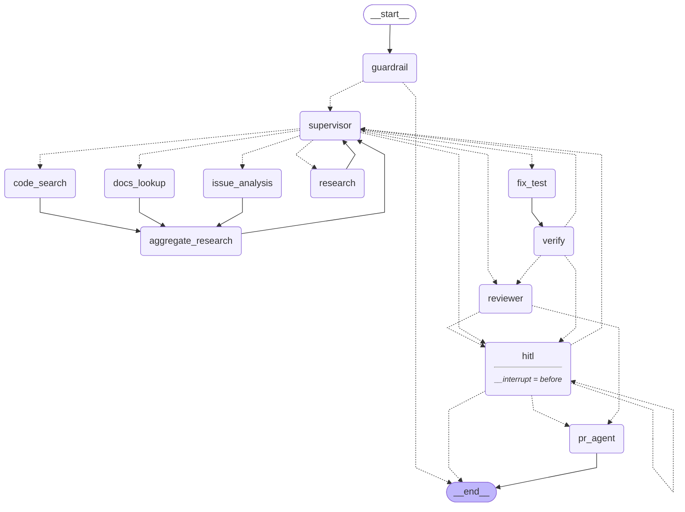

# AgentGate SWE StateGraph Architecture

## Parallel Research & Hybrid Orchestration Architecture

AgentGate implements an autonomous **Parallel Research (Map-Reduce)** pattern combined with a **Hybrid Execution Model**:
- **Supervisor Strategic Judgment**: Evaluates state and dynamically dispatches parallel research workers using LangGraph `Send` when investigation or root-cause discovery is required.
- **Parallel Research Workers (Fan-Out via `Send`)**:
  - `issue_analysis`: Parses problem statement, error logs, and GitHub issue discussions to establish bug mechanics and symptoms.
  - `code_search`: Searches repository codebase for symbols, function definitions, and candidate source/test files needing updates.
  - `docs_lookup`: Retrieves project conventions, README, API contracts, and architecture constraints.
- **Aggregator (Fan-In)**:
  - `aggregate_research`: Synthesizes findings from all three workers into consolidated `research_findings` and candidate `files_changed`, returning control to `supervisor`.
- **Deterministic Python Safety Invariants**: Strictly enforced in code—hard test retry limit (max 3), risk calculation on sensitive paths, and mandatory Human-In-The-Loop (`interrupt_before=["hitl"]`) before any pull request is opened.

---

## Parallel Research & Hybrid Decision Matrix

| Stage | Mode | Responsibility | Output / Invariants |
| :--- | :--- | :--- | :--- |
| **`guardrail`** | Deterministic Code | Verifies repository whitelist and basic input sanitization. | `supervisor` if approved; `END` if rejected. |
| **`supervisor`** | Autonomous Judgment | Dispatches parallel research, orders patch authoring, or escalates early. | `Send` fan-out to parallel workers, `fix_test`, `reviewer`, or `hitl`. |
| **`issue_analysis`** | Parallel Worker | Analyzes GitHub issue discussions, stack traces, and reproduction requirements. | Writes `issue_analysis_result`. |
| **`code_search`** | Parallel Worker | Discovers candidate symbols, functions, and files in repo/sandbox. | Writes `code_search_result` and candidate `files_changed`. |
| **`docs_lookup`** | Parallel Worker | Extracts architecture guidelines, API contracts, and conventions. | Writes `docs_lookup_result`. |
| **`aggregate_research`** | Fan-In Aggregator | Synthesizes all worker outputs into unified intelligence report. | Consolidates into `research_findings` and feeds back to `supervisor`. |
| **`fix_test`** | Autonomous Worker | Authors candidate patch diff and implements unit tests in sandbox. | Applies patch to sandbox; advances to `verify`. |
| **`verify`** | Deterministic Code | Executes pytest/unittest in sandbox and enforces retry cap (max 3). | `reviewer` (passed), `supervisor` (retry), `hitl` (cap reached). |
| **`reviewer`** | Deterministic Code | Evaluates risk score ($\ge 0.7$) against sensitive paths and churn. | `hitl` (high risk) or `pr_agent` (low risk). |
| **`hitl`** | Human Gate | Interrupt before execution (`interrupt_before=["hitl"]`). | `pr_agent` (approved), `supervisor` (feedback), `END` (rejected). |
| **`pr_agent`** | Autonomous Worker | Opens GitHub Pull Request with verified patch and summary. | Produces `pr_url` and advances to `END`. |
